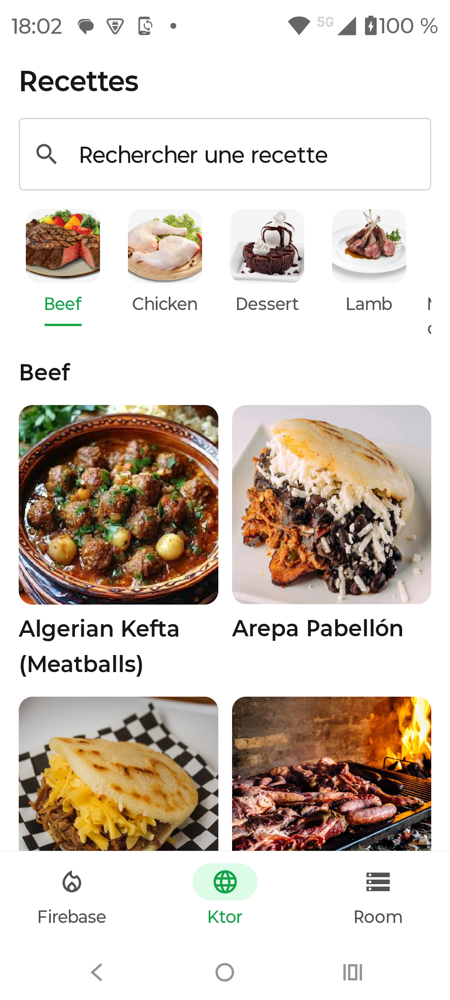
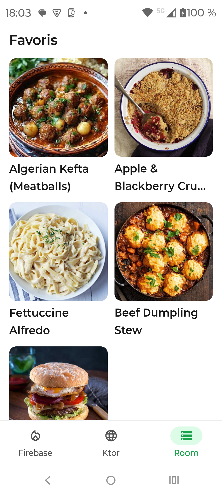

# DemoProject — Kotlin Multiplatform

Application mobile développée avec **Kotlin Multiplatform** et **Compose Multiplatform**, pour Android et iOS.

## Présentation

J'ai développé ce projet pour mettre en pratique et présenter différentes compétences en développement mobile.

L'application regroupe trois fonctionnalités indépendantes, accessibles depuis une navigation commune. Chacune se concentre sur une partie du développement : l'intégration de Firebase, la consommation d'une API REST et la persistance locale des données.

L'objectif n'était pas de créer une application commerciale, mais de construire un projet fonctionnel, structuré et testable, qui puisse servir de support pour présenter mon travail.

## Technologies utilisées

| Domaine | Technologies |
|---|---|
| Langage | Kotlin |
| Multiplateforme | Kotlin Multiplatform |
| Interface | Compose Multiplatform, Material 3 |
| Architecture | MVVM, Clean Architecture |
| Injection de dépendances | Koin |
| Asynchrone | Coroutines, Flow, StateFlow |
| Backend | Firebase Auth, Firestore, Cloud Functions, Storage, Messaging |
| API REST | Ktor Client, Kotlinx Serialization |
| Base de données locale | Room |
| Navigation | Navigation Compose |
| Images | Kamel |
| Tests | Kotlin Test, Mokkery, MockK, Ktor MockEngine |

## Fonctionnalités

L'application est organisée autour de trois onglets.

### 1. Firebase — Réseau social


Le premier onglet présente un petit réseau social utilisant plusieurs services Firebase.

**Fonctionnalités :**
- Inscription et connexion des utilisateurs
- Gestion des profils
- Création et suppression de publications
- Système de likes
- Abonnement et désabonnement aux utilisateurs
- Consultation des abonnés et abonnements
- Statistiques des profils
- Actualisation des données avec Kotlin Flow
- Notification push lors des interractions avec les aboonements, posts et likes

Cette partie montre la gestion des utilisateurs, les interactions entre plusieurs comptes et la synchronisation des données distantes.

**Technologies principales :** Firebase Authentication, Cloud Firestore, Cloud Functions, Firebase Storage et Messaging (intégrés avec la bibliothèque [firebase-kotlin-sdk](https://github.com/GitLiveApp/firebase-kotlin-sdk) de GitLive).

### 2. Ktor — Recherche de recettes



Le deuxième onglet utilise l'API publique **TheMealDB** pour rechercher et consulter des recettes de cuisine.
L'API ne dispose pas de traduction en français.

**Fonctionnalités :**
- Consultation des catégories de recettes
- Recherche par nom
- Filtrage par catégorie
- Affichage des détails et des ingrédients
- Gestion des états de chargement et des erreurs
- Recherche avec délai de saisie (*debounce*)

Les appels HTTP sont réalisés avec Ktor Client. Les réponses JSON sont désérialisées puis converties en modèles du domaine avant d'être utilisées par l'interface.
Cette partie illustre notamment la gestion des appels réseau, des tâches asynchrones et des états de l'interface.

**Technologies principales :** Ktor Client, Kotlinx Serialization et Coroutines.

### 3. Room — Recettes favorites


Le troisième onglet permet de retrouver les recettes enregistrées depuis la partie Ktor.

**Fonctionnalités :**
- Ajout d'une recette aux favoris
- Suppression d'un favori
- Consultation des recettes enregistrées
- Conservation des ingrédients et des informations de la recette
- Mise à jour réactive de la liste des favoris

Les données sont enregistrées localement avec Room et peuvent être consultées sans nouvel appel à l'API.

Les `Flow` permettent d'observer les modifications de la base de données et de mettre automatiquement à jour l'interface.

**Technologies principales :** Room, SQLite et Kotlin Flow.

## Comptes de démonstration

Pour faciliter la découverte de l'application, quatre comptes de test sont disponibles.

Ils permettent de tester les différentes fonctionnalités du réseau social : publications, likes, abonnements et consultation des profils.

| Utilisateur | Adresse e-mail | Mot de passe |
|---|---|---|
| John Doe | `test@mail.com` | `test123456` |
| Jane Doe | `test2@mail.com` | `test123456` |
| Robert De Niro | `test3@mail.com` | `test123456` |
| Zinedine Zidane | `test4@mail.com` | `test123456` |

Les fichiers de configuration Firebase sont déjà inclus dans le projet pour Android et iOS. Aucune configuration Firebase supplémentaire n'est normalement nécessaire pour utiliser les comptes de démonstration.

Ces comptes sont uniquement destinés aux tests. Les données étant partagées, les publications et les interactions peuvent évoluer au fil des utilisations.

## Architecture

Le projet repose sur une architecture **MVVM**, avec une séparation des responsabilités inspirée de la **Clean Architecture**.

```text
Compose UI
    |
ViewModel
    |
UseCase
    |
Repository (interface)
    |
Repository (implémentation)
    |
Firebase / API REST / Room
```

Le code est organisé autour de trois fonctionnalités indépendantes : **Firebase, Ktor et Room**. Chacune possède ses propres couches `data` et `domain`, afin de séparer les repositories, les UseCases et les modèles métier.

Les responsabilités sont réparties de la manière suivante :

- **Presentation :** les écrans Compose, les composants UI réutilisables, les ViewModels et la gestion des états. Les écrans des trois fonctionnalités sont regroupés dans `ui/screens/app`, avec un sous-dossier pour Firebase, Ktor et Room.
- **Domain :** les modèles métier, les interfaces des repositories et les UseCases, organisés séparément pour chaque fonctionnalité.
- **Data :** les implémentations des repositories, les appels réseau, les accès à Firebase et à Room, ainsi que les DTOs et les mappers.

### Organisation du projet

```text
com.souiid.demoproject/
├── di/
├── firebase/
│   ├── data/
│   └── domain/
├── ktor/
│   ├── data/
│   └── domain/
├── room/
│   ├── data/
│   └── domain/
├── platform/
└── ui/
    ├── components/
    └── screens/
        └── app/
            ├── firebase/
            ├── ktor/
            └── room/
```

### Injection de dépendances

L'injection de dépendances est assurée par **Koin**. La configuration est répartie dans plusieurs modules pour distinguer les différentes parties de l'application :

- `firebaseModule` : dépendances liées aux fonctionnalités Firebase.
- `ktorModule` : dépendances liées aux appels API et à Ktor.
- `databaseModule` : dépendances liées à la persistance locale avec Room.
- `platformDatabaseModule` : configuration de la base de données propre à chaque plateforme.

Ces modules sont regroupés lors de l'initialisation de Koin.

Cette organisation permet de garder les fonctionnalités relativement indépendantes, de faciliter la maintenance et de tester les différentes couches séparément.

## Tests

J'ai ajouté des tests sur plusieurs parties de l'application afin de vérifier les comportements sans dépendre systématiquement des services externes.

Les tests concernent notamment :

- Les **UseCases**, pour vérifier les appels aux repositories et les résultats retournés.
- Les **Repositories**, pour vérifier les conversions de données et les opérations effectuées.
- Les **ViewModels**, pour contrôler les états exposés à l'interface, les erreurs et les opérations asynchrones.
- Les appels **Ktor**, avec `MockEngine` pour simuler les réponses HTTP.
- Certaines opérations **Firebase**, à l'aide des émulateurs locaux.

J'utilise principalement **Kotlin Test**, **Mokkery**, **MockK** et **Kotlinx Coroutines Test**.

## Sécurité et configuration de production

Ce projet est une application de démonstration. Pour une distribution en production, plusieurs points mériteraient une attention particulière.

### Gestion des clés API

Dans une application mobile, une clé intégrée au binaire peut être récupérée, même si elle a été injectée pendant la compilation.

Pour les services nécessitant une véritable clé secrète, je privilégierais un backend chargé d'effectuer les appels et de conserver les identifiants sensibles côté serveur.

Les configurations propres aux environnements pourraient être gérées avec des variables de configuration et des secrets CI/CD, en évitant de placer des informations sensibles dans le dépôt Git.

Concernant Firebase, les clés de configuration clientes ne constituent pas à elles seules une protection des données. La sécurité repose notamment sur l'authentification, les règles Firestore et Storage, les contrôles d'autorisation et les restrictions applicables aux clés.

### Obfuscation du code

Pour une version Android destinée à être distribuée, j'activerais **R8** afin de réduire, optimiser et obfusquer le code de l'application.

Cela permet notamment de diminuer la taille du binaire et de compliquer l'analyse du code compilé.

L'obfuscation ne remplace toutefois pas les contrôles de sécurité et ne permet pas de rendre une clé API secrète.

### Autres points à prévoir

Avant une mise en production, je compléterais également le projet avec une configuration de release adaptée à chaque plateforme, des vérifications de sécurité, un suivi des erreurs et une automatisation des builds et des tests.

## Objectif du projet

Ce projet me sert de support pour présenter mon approche du développement mobile : construire des fonctionnalités complètes, organiser le code par responsabilités et utiliser des outils adaptés à chaque besoin.

Il me permet également d'expérimenter et d'approfondir Kotlin Multiplatform, avec une base de code partagée entre Android et iOS.

---

**Développé avec Kotlin Multiplatform et Compose Multiplatform.**